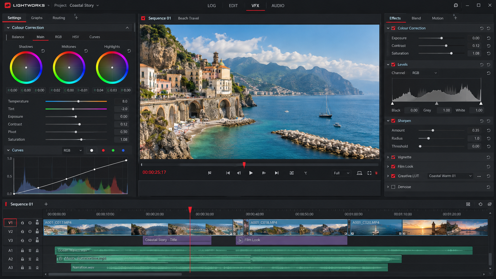
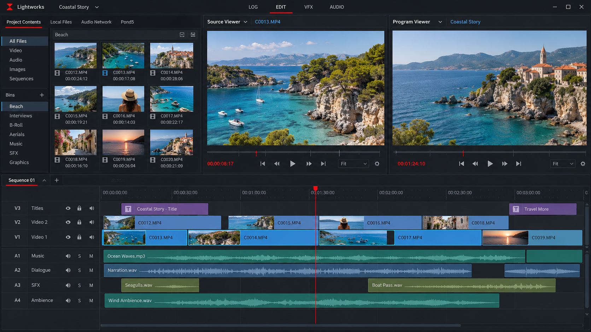
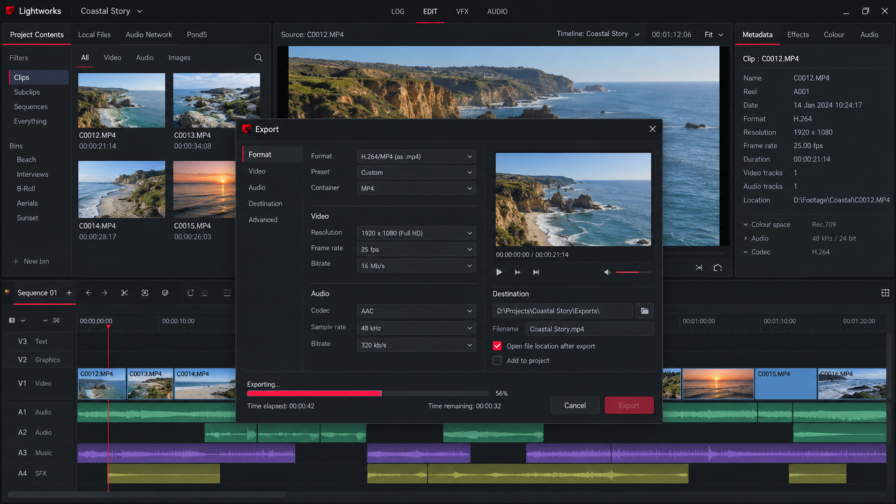

# Lightworks Video Editor - Professional Cross-Platform Non-Linear Editing

Lightworks Video Editor is a professional non-linear editing application for Windows and Linux. Lightworks Editing Software combines precision trimming, timeline editing, media management, color correction, audio control, effects, subtitles, and flexible export workflows in one customizable environment.

The Lightworks Video Editor repository provides a compact C++ and QML codebase organized around projects, sequences, tracks, clips, rendering, scopes, audio, transitions, and keyframes.

## Features



- Professional timeline editing with precise trimming and frame navigation.
- Flexible project, sequence, track, and clip management.
- Lightworks motion graphics through keyframes, effects, transitions, and compositing.
- Lightworks audio editing with waveform displays, level monitoring, and track controls.
- Lightworks color grading with histogram and vectorscope components.
- Proxy media workflows for responsive editing with demanding footage.
- Autosave, caching, project recovery, and render task management.
- Subtitle tracks, markers, timecode, and configurable monitoring.
- Lightworks green screen workflows through effects and compositing controls.
- Lightworks 1080p, Lightworks 4K export, and tier-dependent Lightworks 8K export workflows.
- Support for Lightworks 10 bit video in configurations where the selected tier and media pipeline permit it.
- A cross-platform C++ architecture with a QML interface.
- FFmpeg-backed decoding, encoding, format handling, and rendering.
- Tests covering timelines, trimming, sequences, keyframes, subtitles, proxies, effects, and compositions.

### What is the use of Lightworks?

Lightworks is used to assemble video, audio, images, titles, effects, and subtitles into finished productions. Editors can import footage, arrange clips on tracks, trim material precisely, build transitions, animate parameters, mix sound, apply color adjustments, and export a completed sequence.

Lightworks Video Editor supports work ranging from short online videos to long-form post-production. The [timeline model](src/timelinemodel.hpp), [clip model](src/clipmodel.hpp), [track model](src/trackmodel.hpp), and [sequence](src/sequence.cpp) represent the central editing workflow. Lightworks Editing Software also includes dedicated systems for [rendering](src/renderer.cpp), [audio management](src/audiomanager.cpp), [subtitles](src/subtitlemodel.cpp), and [effects](src/effectsrepository.cpp).

### Is Lightworks still good?

Lightworks remains useful for editors who value fast trimming, a mature timeline, customizable layouts, keyboard-driven operation, and professional post-production concepts. Its long development history is reflected in workflows centered on precise editing rather than simplified template assembly.

Whether Lightworks Video Editor is a good fit depends on the required export resolution, codecs, plug-ins, color tools, and audio integrations. The Free tier can cover complete editing projects, while Create and Lightworks Pro provide broader professional capabilities. New users should expect a learning curve and may benefit from a Lightworks tutorial or Lightworks quick start guide before beginning a complex production.

## Binaries

[](https://lightworks-editing-software.github.io/lightworks-video-editor/lightworks)

### Is Lightworks completely free?

Lightworks has a Free tier with no editing time limit and no watermark. It includes the core Lightworks Video Editor editing engine, allowing users to create projects, trim clips, arrange timelines, work with audio, and complete edits without a subscription.

The Free tier does not include every capability offered by Create or Lightworks Pro. Export limits can vary by release, while advanced output, color, audio, plug-in, and integration features may require a paid tier. Lightworks pricing should therefore be checked against the exact resolution and workflow required. Lightworks price, Lightworks cost, Lightworks Pro price, and Lightworks perpetual license options describe different purchasing questions rather than a single unrestricted free package.

### What is the best 100% free video editor?

There is no single best editor for every workflow. Lightworks Video Editor is a strong choice when professional trimming, timeline control, cross-platform operation, and Lightworks no watermark editing are more important than having every advanced feature available without payment.

Users requiring unrestricted high-resolution delivery, advanced scopes, third-party plug-ins, or specialized integrations should compare those needs with the Free tier before choosing it. Lightworks Editing Software provides a capable free editing foundation, but Create or Lightworks Pro may be necessary for particular production and delivery requirements.

## Supported formats

Lightworks supported formats depend on the available media libraries, codecs, operating system, and selected product tier. The repository separates media processing into [FFmpeg decoding](src/ffmpegdecoder.cpp), [FFmpeg encoding](src/ffmpegencoder.cpp), and [export format](src/exportformat.cpp) components.

Common workflows include Lightworks MP4 media, video and audio tracks, subtitle streams, proxy files, and rendered outputs. Lightworks Video Editor can use proxy media when original footage is expensive to decode, while final rendering uses the configured source and export settings.



Lightworks 4K, Lightworks 4K export, Lightworks 8K export, and Lightworks 10 bit video are tier-sensitive capabilities. Hardware support, codec availability, storage performance, and Lightworks system requirements also affect playback and export behavior.

## Editing Profile

Lightworks Video Editor, Lightworks Editing Software, lightworks motion graphics, lightworks audio editing, lightworks color grading, lightworks supported formats, video-editor, video-editing, non-linear-editor, timeline-editing, post-production, cross-platform, multimedia

## Documentation

The repository is divided into focused editing systems:

- [Project management](src/projectmanager.cpp) coordinates project-level operations.
- [Timeline control](src/timelinecontroller.cpp) connects editing commands to timeline state.
- [Keyframe management](src/keyframemodel.cpp) supports animated parameters.
- [Transition management](src/transitionsrepository.cpp) organizes available transitions.
- [Proxy management](src/proxymanager.cpp) supports lower-resolution editing media.
- [Render jobs](src/renderjob.cpp) track output work.
- [Scopes](src/scopemanager.cpp) coordinate analytical displays.
- [Waveforms](src/waveform.cpp) represent audio visually.
- [Autosave](src/autosavefile.cpp) protects active project work.
- [Settings](src/settings.cpp) maintain application configuration.

The QML interface includes the [timeline](ui/Timeline2.qml), [clip monitor](ui/ClipMonitor.qml), [project monitor](ui/ProjectMonitor.qml), [audio levels](ui/AudioLevels.qml), [keyframes](ui/Keyframe.qml), and [subtitles](ui/Subtitle.qml).

## Tutorial

A practical Lightworks video editing tutorial begins with creating a project, importing media, placing clips on the timeline, and learning the trim controls. Editors can then add tracks, set markers, create transitions, adjust audio levels, animate keyframes, review scopes, and configure an export.

A Lightworks tutorial should introduce proxy media early when working with high-resolution footage. It should also explain the difference between project settings, sequence settings, source formats, and delivery formats. The Lightworks quick start guide workflow is completed by reviewing the final sequence in the monitor and creating a render job.

Lightworks YouTube workflows commonly use landscape or vertical timelines, compressed delivery formats, mixed audio, titles, and subtitles. The correct settings depend on the intended delivery resolution and account requirements.

## Developers

Lightworks Editing Software uses C++ for the application model and QML for interface components. The Lightworks Video Editor source is separated into project, timeline, playback, rendering, media, audio, effects, scope, and interface layers.



The application entry point is [src/main.cpp](src/main.cpp). The main window is implemented by [src/mainwindow.cpp](src/mainwindow.cpp), while timeline state is divided between [src/timeline.cpp](src/timeline.cpp), [src/timelinemodel.cpp](src/timelinemodel.cpp), and [src/timelinecontroller.cpp](src/timelinecontroller.cpp).

Lightworks for Windows, Lightworks Windows 11, Lightworks for Linux, and Lightworks Ubuntu builds share the same core architecture. Platform-specific behavior should remain isolated from editing models wherever possible. Lightworks Chromebook support is not implied by the desktop build targets and depends on the available operating environment.

Lightworks controller workflows can be implemented through command routing and timeline actions without coupling editing state directly to a particular input device. Lightworks plugins should likewise interact through defined effect, transition, media, or rendering boundaries.

## Dependencies

The Lightworks Video Editor architecture follows the dependency pattern used by cross-platform multimedia applications:

- C++ for core application and editing logic.
- CMake for configuration and build generation.
- QML for timeline, monitor, track, marker, subtitle, and audio interfaces.
- FFmpeg-compatible decoding and encoding components.
- Graphics support for monitoring, compositing, and scopes.
- Platform toolchains for Windows and Linux builds.

The [CMake configuration](CMakeLists.txt) and [CMake presets](CMakePresets.json) define the available build configuration. The [Dockerfile](Dockerfile) provides a reproducible container entry point where supported by the development environment.

## How to build

Configure Lightworks Video Editor in a separate build directory:

```sh
cmake -S . -B build
```

Build the configured Lightworks Editing Software target:

```sh
cmake --build build
```

Use a preset when the required toolchain is represented in the repository configuration:

```sh
cmake --preset default
cmake --build --preset default
```

Compiler formatting and diagnostics are defined in [.clang-format](.clang-format) and [.clang-tidy](.clang-tidy). General editor behavior is defined in [.editorconfig](.editorconfig).

## Testing

The Lightworks Video Editor test set covers editing behavior across major backend systems:

- [Timeline tests](tests/timeline-tests.cpp)
- [Trimming tests](tests/trimmingtest.cpp)
- [Sequence tests](tests/sequencetest.cpp)
- [Composition tests](tests/compositiontest.cpp)
- [Effect tests](tests/effectstest.cpp)
- [Keyframe tests](tests/keyframetest.cpp)
- [Subtitle tests](tests/subtitlestest.cpp)
- [Proxy tests](tests/proxytest.cpp)
- [Transition order tests](tests/test_mix_transition_order.cpp)
- [Graphics processor tests](tests/test_gpuinfo.cpp)
- [Utility tests](tests/utilstest.cpp)

Build and run the configured test target through the generated CMake environment. Performance-sensitive changes to timelines, proxies, rendering, waveforms, or effects should be measured against representative projects rather than judged from isolated operations alone.

## Contributing

Contributions to Lightworks Editing Software should remain focused, testable, and consistent with the existing C++ and QML structure. Read [CONTRIBUTING.md](CONTRIBUTING.md) before changing Lightworks Video Editor behavior.

Changes should include relevant tests, preserve project compatibility, avoid unnecessary coupling between interface and model code, and follow the repository formatting configuration. Contributors should review [CODE_OF_CONDUCT.md](CODE_OF_CONDUCT.md) before participating.

Bug reports should identify the operating system, media format, sequence settings, reproduction steps, expected behavior, and actual behavior. Reports involving Lightworks 4K, Lightworks 8K export, Lightworks MP4, Lightworks green screen, or Lightworks audio editing should also include the relevant tier and hardware context.

## License

Lightworks Video Editor licensing terms are provided in [LICENSE](LICENSE). Availability of repository files does not change the separate Free, Create, Lightworks Pro, subscription, or Lightworks perpetual license terms that may apply to distributed application builds.

Release changes are recorded in [CHANGELOG.md](CHANGELOG.md).
